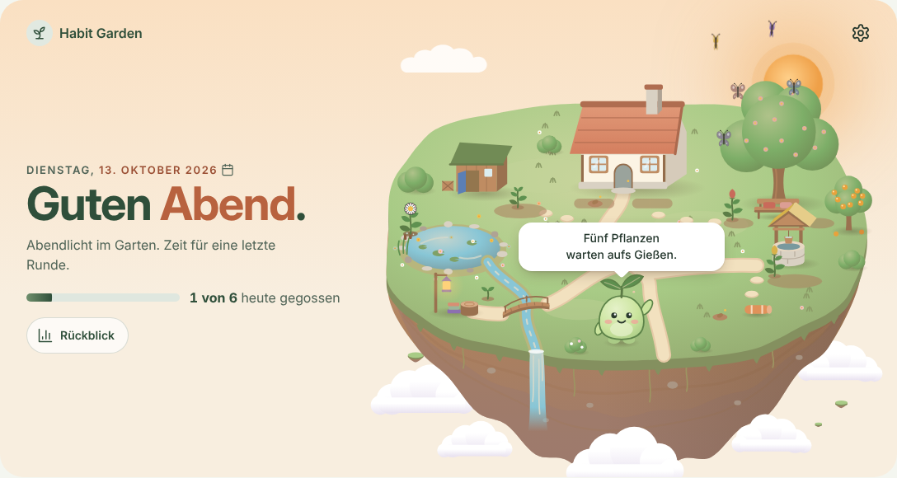
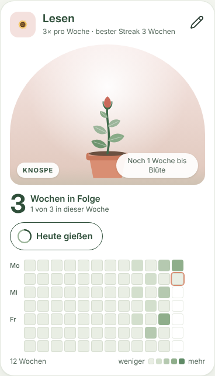
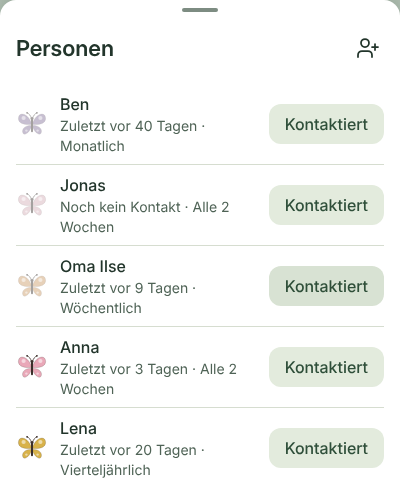

# Habit Garden

Habit Garden ist ein Garten für deinen Alltag. Jede Gewohnheit, die du pflegen möchtest, wächst darin als Pflanze. Je regelmäßiger du sie pflegst, desto weiter wächst sie: vom Samen über Spross, Blätter und Knospe bis zur Blüte. Menschen, bei denen du dich melden möchtest, fliegen als Schmetterlinge durch den Garten.

**Ausprobieren:** [daimpad.github.io/habit-garden](https://daimpad.github.io/habit-garden/). Unter Einstellungen › Info kannst du Beispieldaten laden und den Garten gleich gefüllt sehen.

## Die Idee

Selbstorganisation gelingt leichter, wenn man sieht, was man schon aufgebaut hat. Habit Garden macht Regelmäßigkeit sichtbar, statt sie in Listen und Zahlen zu verstecken. Ein ausgelassener Tag lässt keine Pflanze verwelken: Sie fällt höchstens auf den Spross zurück und wächst von dort wieder. Die Texte bleiben ruhig und sachlich: keine Lobformeln, kein Druck.

Du ordnest dein Leben in Bereiche wie Gesundheit, Beziehungen oder Beruf. Jeder Bereich ist ein Beet mit eigener Blume.

## Was Habit Garden heute kann

- **Der Garten auf einen Blick.** Oben auf der Startseite stehen alle Bereiche als Beete, jede Gewohnheit als Pflanze in ihrem aktuellen Wachstum. Der Himmel folgt der Tageszeit, und eine Begrüßung zeigt, wie viel du heute schon gegossen hast.
- **Gewohnheiten pflegen.** Jede Gewohnheit hat eine eigene Karte mit ihrer Pflanze, der Anzahl der Tage in Folge und einem Überblick über die letzten zwölf Wochen. Ein Tipp auf „Heute gießen“ genügt; die Karte zeigt auch, wie lange es bis zur nächsten Stufe dauert. Gewohnheiten können täglich, an bestimmten Wochentagen oder einige Male pro Woche stattfinden.
- **In Kontakt bleiben.** Du trägst Menschen ein, die dir wichtig sind, und legst fest, wie oft du dich melden möchtest. „Melde dich bei“ erinnert dich an die, bei denen es Zeit wird. Wer im Rhythmus ist, fliegt als bunter Schmetterling; wer länger nichts von dir gehört hat, ruht blass im Gras.
- **Fokus für den Tag.** Du wählst bis zu drei Aufgaben, die heute wirklich zählen. Fällige Aufgaben erscheinen darunter, auf Wunsch mit einer Erinnerung, solange die Seite geöffnet ist.
- **Aufgaben, die wiederkommen.** Eine Aufgabe kann sich täglich, werktags, wöchentlich, monatlich oder einige Tage nach dem Erledigen wiederholen. Hakst du sie ab, steht die nächste schon bereit. Unteraufgaben machen aus einer Aufgabe eine kleine Checkliste.
- **Schnell notieren.** Beim Anlegen genügt eine Zeile: „Steuer machen @finanzen morgen ! #geld 14:00“ wird zu einer wichtigen Aufgabe im Bereich Finanzen, morgen um 14 Uhr.
- **Den Abend nutzen.** Am Abend erscheint eine Karte „Morgen vorbereiten“. Dort wählst du die Aufgaben für morgen, und am Morgen stehen sie schon im Fokus.
- **Stimmung und Journal.** Mit einem Tipp hältst du fest, wie es dir heute geht, und kannst einen kurzen Gedanken dazuschreiben.

  
  

## Was noch kommt

- **Planung:** Projekte und verschiedene Ansichten deiner Aufgaben, etwa als Liste oder Tafel.
- **Wissen:** Notizen mit Schlagworten und einer Suche, damit Gedanken nicht verloren gehen.
- **Rückblick und Kalender:** ein Blick zurück auf die vergangenen Wochen und ein dunkles Erscheinungsbild für den Abend.

## Deine Daten

Habit Garden braucht kein Konto. Alles, was du einträgst, bleibt in deinem Browser auf deinem Gerät und wird an keinen Server geschickt. Deshalb lohnt es sich, unter Einstellungen › Daten regelmäßig eine Sicherung zu speichern. Mit der Sicherungsdatei kannst du deinen Garten auch auf ein anderes Gerät mitnehmen. Safari löscht Daten von Websites, die sieben Tage nicht geöffnet wurden; liegt deine letzte Sicherung einige Tage zurück, erinnert dich die App daran.

---

Für Entwicklerinnen und Entwickler: Aufbau, Build und Auslieferung beschreibt [docs/ENTWICKLUNG.md](docs/ENTWICKLUNG.md). Habit Garden steht unter der Apache License 2.0.
